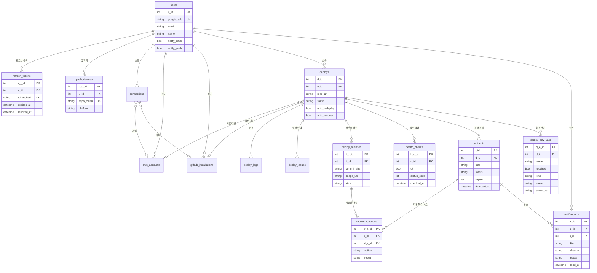

# ERD와 테이블 구조

현재 테이블은 6개(`deploys`, `deploy_logs`, `deploy_issues`, `aws_accounts`, `github_installations`, `connections`)이고, 여기에 **사용자·인증·운영·알림·환경변수 테이블 9개**를 더한다. 이름 규칙은 `docs/conventions.md`를 따른다 (PK는 단어 머리글자: `u_id`, `r_t_id`).

## 1. ERD

위 그림은 핵심 컬럼만 보인다. 전체 컬럼은 아래 표에 있다. 기존 테이블(`deploy_logs`, `deploy_issues`, `aws_accounts`, `github_installations`, `connections`)의 컬럼은 `features/*/models.py`와 같고, `u_id`만 늘어난다.

## 2. 기존 테이블의 변경

| 테이블 | 변경 | 이유 |
|---|---|---|
| `deploys` | `u_id` FK(nullable) 추가 | 소유자. 3단계 전까지 null |
| `deploys` | `auto_recover` bool, 기본 true 추가 `[가정]` | 배포별 자동 복구 스위치 (D-09) |
| `deploys` | `size_tier`(`small\|medium\|large`), `cpu`, `memory`(허용 값은 Express Mode 확인 후), `advice`(추천 결과 JSON, text), `advice_at` 추가 | 사용자가 고른 사양과 배포 시점의 추천을 함께 보관 (FR-21, I-09) |
| `deploys` | `last_health_at`, `health_state`(`healthy\|unhealthy\|unknown`) 추가 | 목록에서 헬스 배지를 빠르게 보이려고. `health_checks`를 매번 세지 않는다 |
| `aws_accounts` | `u_id` FK(nullable) 추가 | 소유자 |
| `github_installations` | `u_id` FK(nullable) 추가 | 소유자. `installation_id`는 지금처럼 전역 unique |
| `connections` | `u_id` FK(nullable) 추가 | 소유자 |
| `deploy_logs`, `deploy_issues` | 변경 없음 | `d_id`로 소유자를 따라간다 |

**상태값(`deploys.status`)은 원칙적으로 바꾸지 않는다.** 복구 중인지는 `incidents.status`가 가진다. (바꾸면 CLAUDE.md의 세 곳을 같이 고쳐야 한다.) 유일한 후보 변경은 환경변수 입력 대기용 `needs_input` 하나이고, 결정 D9가 정해지기 전까지는 추가하지 않는다.

**마이그레이션.** 지금은 `create_all`이라 기존 테이블에 컬럼이 안 늘어난다. 이 변경은 컬럼 추가가 많으므로 alembic을 붙이거나, 개발 DB를 새로 만든다 (`architecture.md`가 이미 "컬럼을 바꿀 일이 잦아지면 alembic"이라고 적어 두었다). 상용 단계에서는 alembic이 필수다.

## 3. 새 테이블

### users — 사용자 (3단계)
| 컬럼 | 타입 | Null | 설명 |
|---|---|---|---|
| `u_id` | int PK | N | |
| `google_sub` | varchar(64) | N | Google 계정의 고유 식별자. **unique**. 이메일이 바뀌어도 같은 사람 |
| `email` | varchar(255) | N | 알림 메일 수신 주소 |
| `name` | varchar(100) | Y | |
| `picture_url` | varchar(500) | Y | |
| `notify_email` | bool | N | 기본 true |
| `notify_push` | bool | N | 기본 true |
| `status` | varchar(20) | N | `active\|deleting\|deleted` |
| `last_login_at` | timestamp | Y | |
| `created_at`, `updated_at` | timestamp | N | |

### refresh_tokens — 로그인 유지 (3단계)
| 컬럼 | 타입 | Null | 설명 |
|---|---|---|---|
| `r_t_id` | int PK | N | |
| `u_id` | int FK → users, index | N | 삭제 시 CASCADE |
| `token_hash` | varchar(64) | N | **원문이 아니라 해시**를 저장. unique |
| `platform` | varchar(10) | N | `web\|ios\|android` |
| `expires_at` | timestamp | N | |
| `revoked_at` | timestamp | Y | 로그아웃·회전·탈취 의심 시 |
| `replaced_by` | int | Y | 회전한 새 토큰 `r_t_id`. 이미 쓴 토큰이 다시 오면 계열 전체 폐기 |
| `created_at` | timestamp | N | |

### push_devices — 앱 기기 (2단계)
| 컬럼 | 타입 | Null | 설명 |
|---|---|---|---|
| `p_d_id` | int PK | N | |
| `u_id` | int FK, nullable(3단계 전) | Y | |
| `expo_token` | varchar(255) | N | unique. 한 기기에 한 토큰 |
| `platform` | varchar(10) | N | `ios\|android` |
| `last_seen_at` | timestamp | N | 오래 안 보이면 정리 |
| `created_at` | timestamp | N | |

### deploy_releases — 배포된 버전 (2단계)
되돌리기의 재료다. `deploying`이 성공할 때마다 한 줄 쌓는다.
| 컬럼 | 타입 | Null | 설명 |
|---|---|---|---|
| `d_r_id` | int PK | N | |
| `d_id` | int FK → deploys, index | N | CASCADE |
| `commit_sha` | varchar(40) | Y | |
| `image_uri` | varchar(500) | N | ECR 이미지 |
| `state` | varchar(10) | N | `active\|previous\|retired` — 지금 떠 있는 것 / 직전 정상 / 보관 기한 지남 |
| `healthy_since` | timestamp | Y | 이 버전이 정상 확인된 첫 시각. 정상 확인된 적 없는 버전은 되돌릴 대상이 아니다 |
| `created_at` | timestamp | N | |

ECR 이미지를 지우는 작업(작업 종료, 삭제)과 함께 `retired`로 바꾼다. 보관 개수 기본 3 `[가정]`.

### deploy_env_vars — 환경변수 (1단계)
배포마다 필요한 환경변수의 **이름과 상태**를 둔다. 시크릿 **값은 이 표에 없다.**
| 컬럼 | 타입 | Null | 설명 |
|---|---|---|---|
| `d_e_id` | int PK | N | |
| `d_id` | int FK → deploys, index | N | CASCADE. `(d_id, name)` unique |
| `name` | varchar(100) | N | 변수 이름 |
| `required` | bool | N | 코드에 기본값이 없으면 true |
| `has_default` | bool | N | 코드에 기본값이 있음 |
| `kind` | varchar(20) | N | `database\|cache\|external_api\|secret\|config\|unknown` |
| `source` | varchar(20) | N | `code\|compose\|example\|readme\|runtime_error\|user` — 어디서 알았나 |
| `source_hint` | varchar(255) | Y | 찾은 위치(`app/config.py:12`). 값이 아님 |
| `status` | varchar(10) | N | `detected\|set\|skipped` |
| `storage` | varchar(20) | N | `none\|plain\|secret_store` — 값이 어디에 있나 |
| `plain_value` | text | Y | `kind=config`이고 `storage=plain`일 때만. 시크릿은 절대 여기에 넣지 않는다 `[가정]` |
| `secret_ref` | varchar(500) | Y | 사용자 AWS 보안 저장소 항목의 ARN (`storage=secret_store`) |
| `created_at`, `updated_at` | timestamp | N | |

값 입력 API는 쓰기 전용이고 응답에는 `has_value`만 돌려준다. 보안 저장소 항목은 `managed-by: deploy-wizard` 태그를 달아 정리 때 우리 것만 지운다.

### health_checks — 헬스 결과 (2단계)
| 컬럼 | 타입 | Null | 설명 |
|---|---|---|---|
| `h_c_id` | int PK | N | |
| `d_id` | int FK, index | N | CASCADE |
| `ok` | bool | N | |
| `status_code` | int | Y | 응답이 없으면 null |
| `latency_ms` | int | Y | |
| `detail` | varchar(255) | Y | 시간 초과, 연결 거부 등 |
| `checked_at` | timestamp, index | N | |

양이 빨리 늘어나는 표다. 7일이 지난 행은 정리한다 `[가정]`. (60초 × 배포 수 × 7일)

### incidents — 운영 문제 (2단계)
| 컬럼 | 타입 | Null | 설명 |
|---|---|---|---|
| `i_id` | int PK | N | |
| `d_id` | int FK, index | N | CASCADE |
| `kind` | varchar(20) | N | `unhealthy\|crash_loop\|bad_release\|unknown` |
| `status` | varchar(20) | N | `open\|recovering\|resolved\|needs_action` |
| `summary` | varchar(255) | Y | 한 줄 요약 (알림 제목에 쓴다) |
| `explain` | text | Y | `Incident_Explain` JSON: `summary`, `cause`, `fix_where`, `actions[]`, `source`(`rule\|llm\|none`). 마스킹 후 저장 |
| `evidence` | text | Y | 원인 수집 결과 요약(로그 끝부분 등). 마스킹 후, 크기 제한 |
| `detected_at` | timestamp | N | |
| `resolved_at` | timestamp | Y | |
| `created_at`, `updated_at` | timestamp | N | |

한 배포에 `open`/`recovering` 인시던트는 동시에 하나만 둔다 (중복 알림 방지).

### recovery_actions — 자동 복구 시도 (2단계)
| 컬럼 | 타입 | Null | 설명 |
|---|---|---|---|
| `r_a_id` | int PK | N | |
| `i_id` | int FK, index | N | CASCADE |
| `action` | varchar(20) | N | `restart\|rollback` (이 둘뿐 `[가정]`) |
| `d_r_id` | int FK → deploy_releases | Y | 되돌리기 대상 버전 |
| `result` | varchar(10) | N | `running\|ok\|failed` |
| `detail` | text | Y | 실패 이유 (마스킹) |
| `started_at`, `finished_at` | timestamp | | |

### notifications — 알림 (2단계)
한 사건당 채널별로 한 줄씩 쌓는다 (앱 안 목록·메일·푸시).
| 컬럼 | 타입 | Null | 설명 |
|---|---|---|---|
| `n_id` | int PK | N | |
| `u_id` | int FK, nullable(3단계 전), index | Y | |
| `d_id` | int | Y | 바로가기용 |
| `i_id` | int FK → incidents | Y | |
| `kind` | varchar(30) | N | `incident_opened\|incident_recovered\|incident_needs_action\|deploy_succeeded\|deploy_failed\|new_commit` |
| `channel` | varchar(10) | N | `inapp\|email\|push` |
| `title` | varchar(200) | N | |
| `body` | text | N | 마스킹 후 |
| `status` | varchar(10) | N | `queued\|sent\|failed` |
| `error` | text | Y | 발송 실패 이유 |
| `read_at` | timestamp | Y | `inapp`만 쓴다 |
| `sent_at` | timestamp | Y | |
| `created_at` | timestamp | N | |

## 4. 인덱스와 제약 요약

| 대상 | 제약 |
|---|---|
| `users.google_sub` | unique |
| `refresh_tokens.token_hash` | unique |
| `push_devices.expo_token` | unique |
| `github_installations.installation_id` | unique (기존) |
| `deploy_logs.d_id`, `deploy_issues.d_id`, `health_checks.d_id`, `incidents.d_id` | index |
| `notifications(u_id, read_at)` | 읽지 않은 알림 수 조회용 |
| 소유자 조회 | 모든 목록 쿼리는 `u_id = 현재 사용자`로 먼저 거른다 |

## 5. 삭제 규칙

| 지울 때 | 같이 지워지는 것 | 지우지 않는 것 |
|---|---|---|
| 배포 삭제(`deleted`) | 로그, 이슈, 릴리스, 헬스, 인시던트(CASCADE) | 알림은 남긴다 (`d_id`만 남고 링크는 끊김) |
| 사용자 삭제 | 토큰, 기기, 알림, 사용자 소유 기록 | **AWS 리소스** — 자동으로 지우지 않는다 |
| 연결 해제 | 그 연결로 만든 배포의 연결 FK를 null | 사용자 AWS 계정의 스택, GitHub 앱 설치 |
