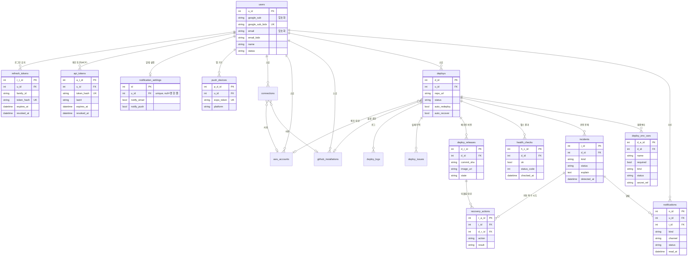

# ERD와 테이블 구조

> **구현 상태 (2026-11-17, 로그인 계획 `feat/login-backend`)**: `users`·`refresh_tokens`·`api_tokens`(PAT)와 모든 최상위 표의 `u_id`는 **구현됨**이다. 아래 표는 구현에 맞췄다 — 설계와 달라진 곳은 `users`(개인 정보 암호화 + 블라인드 인덱스, 알림 스위치는 `notification_settings`로), `refresh_tokens.family_id`, `api_tokens`(새 표), `notification_settings.u_id`다. 로그인 플랫폼은 `web`·`android`이고 iOS 는 2026-11-16 에 뺐지만 **한 줄로 되살릴 수 있다**: `features/auth/scheme.py`의 `LOGIN_PLATFORMS` 매핑에 `'ios'` 한 줄 + `GOOGLE_CLIENT_ID_IOS` 설정 + `features/notifications/scheme.py`의 `SUPPORTED_PUSH_PLATFORMS` 상수 ([iOS 제거](./README.md#ios-제거-2026-11-16-사용자-결정)).

현재 테이블은 6개(`deploys`, `deploy_logs`, `deploy_issues`, `aws_accounts`, `github_installations`, `connections`)이고, 여기에 **사용자·인증·운영·알림·환경변수 테이블 9개**를 더한다 (D1 구현에서 한 줄짜리 `notification_settings`가 하나 더 생겼다). 이름 규칙은 `docs/conventions.md`를 따른다 (PK는 단어 머리글자: `u_id`, `r_t_id`).

## 1. ERD

위 그림은 핵심 컬럼만 보인다. 전체 컬럼은 아래 표에 있다. 기존 테이블(`deploy_logs`, `deploy_issues`, `aws_accounts`, `github_installations`, `connections`)의 컬럼은 `features/*/models.py`와 같고, `u_id`만 늘어난다.

## 2. 기존 테이블의 변경

| 테이블 | 변경 | 이유 |
|---|---|---|
| `deploys` | `u_id` FK(nullable) 추가 — **구현됨 (로그인 계획 Task 5)** | 소유자. `AUTH_ENABLED=false` 에서는 새 배포도 null, 켜면 만든 사용자. 옛 기록은 `migrate_login.py assign-owner` 로 채운다 |
| `deploys` | `auto_recover` bool, 기본 true 추가 `[가정]` — **구현됨 (D1)** | 배포별 자동 복구 스위치 (D-09) |
| `deploys` | `size_tier`(`small\|medium\|large`), `cpu`, `memory`(허용 값은 Express Mode 확인 후), `advice`(추천 결과 JSON, text), `advice_at` 추가 | 사용자가 고른 사양과 배포 시점의 추천을 함께 보관 (FR-21, I-09) |
| `deploys` | `last_health_at`, `health_state`(`healthy\|unhealthy\|unknown`) 추가 — **구현됨 (D1)** | 목록에서 헬스 배지를 빠르게 보이려고. `health_checks`를 매번 세지 않는다 |
| `deploys` | `bad_commit_sha` varchar(40), nullable 추가 — **구현됨 (D1, 설계에 없던 열)** | 자동 되돌리기가 기억하는 나쁜 커밋. 감시(폴링·웹훅)가 같은 커밋을 다시 배포하지 않게 한다. 더 새 커밋이 오면 비운다. API 응답에는 싣지 않는다 |
| `aws_accounts` | `u_id` FK(nullable) 추가 — **구현됨** | 소유자. `role_arn`·`aws_account_id` 는 `Encrypted_Text`(암호화 저장, `==` 검색에 쓰지 않는다) |
| `github_installations` | `u_id` FK(nullable) 추가 — **구현됨** | 소유자. `installation_id`는 지금처럼 전역 unique(평문 - 웹훅·콜백이 이 값으로 찾는다). `account_login` 은 `Encrypted_Text`. 이미 다른 사용자의 설치면 콜백이 `connected=github_taken` 으로 돌려보낸다 |
| `connections` | `u_id` FK(nullable) 추가 — **구현됨** | 소유자 |
| `deploy_logs`, `deploy_issues` | 변경 없음 | `d_id`로 소유자를 따라간다 |

**상태값(`deploys.status`)은 원칙적으로 바꾸지 않는다.** 복구 중인지는 `incidents.status`가 가진다. (바꾸면 CLAUDE.md의 세 곳을 같이 고쳐야 한다.) 유일한 후보 변경은 환경변수 입력 대기용 `needs_input` 하나이고, 결정 D9가 정해지기 전까지는 추가하지 않는다.

**마이그레이션.** `create_all`은 이미 있는 표에 컬럼을 늘리지 않는다. D1 에서는 alembic 대신 `shared/database.py`의 `ensure_columns`를 썼다: 서버를 켤 때 `create_all` 뒤에 `ENSURE_COLUMNS`(지금은 `deploys`의 `auto_recover` `health_state` `last_health_at` `bad_commit_sha`)에 적힌 열이 실제 표에 없으면 `ALTER TABLE ... ADD COLUMN`으로 더한다 (모델의 열 정의와 기본값을 따르고, 여러 번 불러도 안전). 새 표(`health_checks` `incidents` `recovery_actions` `deploy_releases` `notifications` `push_devices` `notification_settings`)는 `create_all`이 만든다. 시험에서는 옛 모양의 표로 확인했지만 **실제 `data/wizard.db`에서의 첫 실행은 아직 해 보지 않았다.** 열을 지우거나 바꾸는 일, 그리고 상용 단계(여러 사용자, 서버 DB)에서는 alembic이 필수다 (`architecture.md`가 "컬럼을 바꿀 일이 잦아지면 alembic"이라고 적어 두었다).

## 3. 새 테이블

### users — 사용자 (3단계) — **구현됨 (로그인 계획 Task 3, 설계에서 달라짐)**
| 컬럼 | 타입 | Null | 설명 |
|---|---|---|---|
| `u_id` | int PK | N | |
| `google_sub` | text(암호문) | N | Google 계정의 고유 식별자. `Encrypted_Text` 로 암호화 저장. 이메일이 바뀌어도 같은 사람 |
| `google_sub_bidx` | varchar(64) | N | `blind_index("google_sub", sub)` — **unique**. 사용자 찾기는 이 값으로만 (`BLIND_INDEX_KEY` 의 HMAC) |
| `email` | text(암호문) | N | 알림 메일 수신 주소 (로그인한 Google 이메일). 암호화 저장 |
| `email_bidx` | varchar(64) | N | `blind_index("email", 소문자 이메일)` — index. `AUTH_ALLOWED_EMAILS`·`scripts/auth_token.py`·`assign-owner` 가 이 값으로 찾는다 |
| `name` | text(암호문) | Y | |
| `picture_url` | text(암호문) | Y | |
| `status` | varchar(20) | N | `active\|deleted` (`deleting` 은 만들지 않았다) |
| `last_login_at` | timestamp | Y | |
| `created_at`, `updated_at` | timestamp | N | |

### refresh_tokens — 로그인 유지 (3단계) — **구현됨**
| 컬럼 | 타입 | Null | 설명 |
|---|---|---|---|
| `r_t_id` | int PK | N | |
| `u_id` | int FK → users, index | N | 삭제 시 CASCADE |
| `family_id` | varchar(32) | N | 로그인 한 번 = 한 계열. 회전해도 같다. 폐기된 토큰이 다시 오면 이 계열 전체를 폐기 |
| `token_hash` | varchar(64) | N | **원문이 아니라 SHA-256 hex** 를 저장. unique |
| `platform` | varchar(10) | N | `web\|android` (ios 추가 가능 - 허용 값은 `features/auth/scheme.py` 의 `LOGIN_PLATFORMS` 하나가 정한다) |
| `expires_at` | timestamp | N | |
| `revoked_at` | timestamp | Y | 로그아웃·회전·탈취 의심 시 |
| `replaced_by` | int | Y | 회전한 새 토큰 `r_t_id`. 이미 쓴 토큰이 다시 오면 계열 전체 폐기 |
| `created_at` | timestamp | N | |

### api_tokens — 개인 토큰 (PAT, MCP 용) — **구현됨 (설계에 없던 표, 로그인 계획 Task 4)**
| 컬럼 | 타입 | Null | 설명 |
|---|---|---|---|
| `a_t_id` | int PK | N | |
| `u_id` | int FK → users, index | N | 삭제 시 CASCADE |
| `name` | varchar(50) | N | 사용자가 붙인 이름 (예: `mcp`) |
| `token_hash` | varchar(64) | N | `dwp_…` 원문의 SHA-256 hex. unique. 원문은 발급 응답에 한 번만 나간다 |
| `last4` | varchar(4) | N | 목록에서 구별하려고 끝 4자리만 |
| `expires_at` | timestamp | Y | 기본 30일, 최대 90일 |
| `last_used_at` | timestamp | Y | 1분에 한 번까지만 갱신 |
| `revoked_at` | timestamp | Y | |
| `created_at` | timestamp | N | |

### push_devices — 앱 기기 (2단계)
| 컬럼 | 타입 | Null | 설명 |
|---|---|---|---|
| `p_d_id` | int PK | N | |
| `u_id` | int FK, nullable(3단계 전) | Y | 로그인을 켠 모드에서 등록하면 그 사용자 |
| `expo_token` | text(암호문) | N | 한 기기에 한 토큰. `Encrypted_Text` 로 암호화, API 응답에는 끝 6자리만 |
| `expo_token_bidx` | varchar(64) | Y | `blind_index` — unique. 같은 토큰 찾기는 이 값으로만 |
| `platform` | varchar(10) | N | `android` (iOS 추가 시 `ios`. 허용 값은 `SUPPORTED_PUSH_PLATFORMS`) |
| `last_seen_at` | timestamp | N | 오래 안 보이면 정리 |
| `created_at` | timestamp | N | |

### deploy_releases — 배포된 버전 (2단계)
되돌리기의 재료다. `deploying`이 성공할 때마다 한 줄 쌓는다.
| 컬럼 | 타입 | Null | 설명 |
|---|---|---|---|
| `d_r_id` | int PK | N | |
| `d_id` | int FK → deploys, index | N | CASCADE |
| `commit_sha` | varchar(40) | Y | |
| `image_uri` | varchar(500) | N | ECR 이미지 |
| `state` | varchar(10) | N | `current\|previous\|old\|failed` — 지금 떠 있는 것 / 되돌릴 대상(직전 하나) / 그보다 오래된 것 / 자동 되돌리기로 버려진 나쁜 버전. (설계의 `active\|previous\|retired`를 구현에서 바꿨다) |
| `healthy_since` | timestamp | Y | 이 버전이 정상 확인된 첫 시각. 정상 확인된 적 없는 버전은 되돌릴 대상이 아니다 |
| `created_at` | timestamp | N | |

`deploying`이 성공해 `running`에 닿으면(`services_deploy_release_record`) `previous`는 `old`로, `current`는 `previous`로 밀고 새 줄을 `current`로 만든다 (같은 이미지·커밋이면 새 줄을 만들지 않는다). 첫 정상 점검에서 `current`의 `healthy_since`를 채운다. 되돌리기 대상은 `previous` 중 `healthy_since`가 있고 `image_uri`가 비지 않았으며 현재 이미지와 다른 것 하나뿐이다. 자동 되돌리기가 성공하면 나쁜 줄은 `failed`, 대상 줄은 `current`가 된다.

**미구현**: 설계의 "ECR 이미지를 지울 때 함께 retire" 와 "보관 개수 3". 작업 종료(`session_end.py`)가 ECR 이미지를 지워도 릴리스 줄은 그대로 남는다 - 그런 줄로 되돌리기를 시도하면 AWS 쪽에서 실패해 `needs_action`으로 끝난다.

### deploy_env_vars — 환경변수 (1단계)
배포마다 필요한 환경변수의 **이름과 상태**를 둔다. 시크릿 **값은 이 표에 없다.**
| 컬럼 | 타입 | Null | 설명 |
|---|---|---|---|
| `d_e_id` | int PK | N | |
| `d_id` | int FK → deploys, index | N | CASCADE. `(d_id, name)` unique |
| `name` | varchar(100) | N | 변수 이름 |
| `required` | bool | N | 코드에 기본값이 없으면 true |
| `has_default` | bool | N | 코드에 기본값이 있음 |
| `kind` | varchar(20) | N | `database\|cache\|external_api\|secret\|config\|unknown` |
| `source` | varchar(20) | N | `code\|compose\|example\|readme\|runtime_error\|user` — 어디서 알았나 |
| `source_hint` | varchar(255) | Y | 찾은 위치(`app/config.py:12`). 값이 아님 |
| `status` | varchar(10) | N | `detected\|set\|skipped` |
| `storage` | varchar(20) | N | `none\|plain\|secret_store` — 값이 어디에 있나 |
| `plain_value` | text | Y | `kind=config`이고 `storage=plain`일 때만. 시크릿은 절대 여기에 넣지 않는다 `[가정]` |
| `secret_ref` | varchar(500) | Y | 사용자 AWS 보안 저장소 항목의 ARN (`storage=secret_store`) |
| `created_at`, `updated_at` | timestamp | N | |

값 입력 API는 쓰기 전용이고 응답에는 `has_value`만 돌려준다. 보안 저장소 항목은 `managed-by: deploy-wizard` 태그를 달아 정리 때 우리 것만 지운다.

### health_checks — 헬스 결과 (2단계)
| 컬럼 | 타입 | Null | 설명 |
|---|---|---|---|
| `h_c_id` | int PK | N | |
| `d_id` | int FK, index | N | CASCADE |
| `ok` | bool | N | |
| `status_code` | int | Y | 응답이 없으면 null |
| `latency_ms` | int | Y | |
| `detail` | varchar(255) | Y | 시간 초과, 연결 거부 등 |
| `checked_at` | timestamp, index | N | |

양이 빨리 늘어나는 표다. 7일이 지난 행은 정리한다 `[가정]`. (60초 × 배포 수 × 7일)

### incidents — 운영 문제 (2단계)
| 컬럼 | 타입 | Null | 설명 |
|---|---|---|---|
| `i_id` | int PK | N | |
| `d_id` | int FK, index | N | CASCADE |
| `kind` | varchar(20) | N | `unhealthy\|crash_loop\|bad_release\|unknown` |
| `status` | varchar(20) | N | `open\|recovering\|resolved\|needs_action` |
| `summary` | varchar(255) | Y | 한 줄 요약 (알림 제목에 쓴다) |
| `explain` | text | Y | `Incident_Explain` JSON: `summary`, `cause`, `fix_where`, `actions[]`, `source`(`rule\|llm\|none`). 마스킹 후 저장 |
| `evidence` | text | Y | 원인 수집 결과 요약(로그 끝부분 등). 마스킹 후, 크기 제한 |
| `detected_at` | timestamp | N | |
| `resolved_at` | timestamp | Y | |
| `created_at`, `updated_at` | timestamp | N | |

한 배포에 끝나지 않은(`open` `recovering` `needs_action`) 인시던트는 동시에 하나만 둔다 (중복 알림 방지, 코드에서 확인 - DB 제약은 없다). `needs_action`도 끝난 것으로 치지 않아야, 사람이 보기 전에 같은 배포가 매 분 새 인시던트를 만들지 않는다.

### recovery_actions — 자동 복구 시도 (2단계)
| 컬럼 | 타입 | Null | 설명 |
|---|---|---|---|
| `r_a_id` | int PK | N | |
| `i_id` | int FK, index | N | CASCADE |
| `action` | varchar(20) | N | `restart\|rollback` (이 둘뿐 `[가정]`) |
| `d_r_id` | int FK → deploy_releases | Y | 되돌리기 대상 버전 |
| `result` | varchar(10) | N | `running\|ok\|failed` |
| `detail` | text | Y | 실패 이유 (마스킹) |
| `started_at`, `finished_at` | timestamp | | |

**`detail` 앞머리 표지(데이터 모델에 영향).** `action=rollback`, `result=failed`인 줄의 `detail`이 `AWS는 이전 이미지로 되돌아갔지만 배포 기록 반영에 실패했습니다`로 시작하면, AWS 는 이전 이미지로 돌아갔는데 배포 기록(`deploys.image_uri` 등)이 못 따라간 상태라는 표지다. 복구 코드는 이 표지를 보고, 그 줄의 `started_at`보다 새로운 `deploy_releases` 줄(= 사용자의 새 배포)이 생기기 전까지 그 배포의 자동 복구를 막는다 (기록이 거짓이라 잘못된 이미지로 재시작할 수 있어서). 별도 열이 없어 이 문구는 코드 상수(`BOOKKEEPING_DETAIL`)와 함께 바뀌어야 한다. 서버 재시작 때 끊긴 조치는 `failed`와 `서버가 다시 시작되어 자동 복구가 중단되었습니다`로 닫는다.

### notification_settings — 알림 설정 (D1, 설계에 없던 표)
사용자마다 한 줄 (**구현됨**, 로그인 계획 Task 7). `AUTH_ENABLED=false` 이거나 주인 없는 배포는 `id=1`, `u_id=null` 줄 하나를 쓴다. 로그인한 사용자는 처음 읽을 때 자기 줄이 기본값으로 만들어진다. 설계의 `users.notify_email`·`notify_push` 는 `users` 가 아니라 이 표에 있다.
| 컬럼 | 타입 | Null | 설명 |
|---|---|---|---|
| `id` | int PK | N | 옛 한 줄은 1 |
| `u_id` | int FK → users, unique, index | Y | 주인. null = 로그인 없는 옛 한 줄 |
| `notify_email` | bool | N | 기본 true. 메일은 `.env`의 `MAIL_HOST`·`MAIL_TO`가 있어야 실제로 나간다 |
| `notify_push` | bool | N | 기본 true. 등록된 기기가 있어야 실제로 나간다 |
| `kinds` | text | N | 받을 알림 종류 JSON 배열 (기본 일곱 가지 전부) |

### notifications — 알림 (2단계)
한 사건당 채널별로 한 줄씩 쌓는다 (앱 안 목록·메일·푸시).
| 컬럼 | 타입 | Null | 설명 |
|---|---|---|---|
| `n_id` | int PK | N | |
| `u_id` | int FK, nullable(3단계 전), index | Y | |
| `d_id` | int | Y | 바로가기용 |
| `i_id` | int FK → incidents | Y | |
| `kind` | varchar(30) | N | `incident_opened\|incident_recovered\|incident_needs_action\|deploy_succeeded\|deploy_failed\|new_commit\|plan_exceeded` |
| `channel` | varchar(10) | N | `inapp\|email\|push` |
| `title` | varchar(200) | N | |
| `body` | text | N | 마스킹 후 |
| `status` | varchar(10) | N | `queued\|sent\|failed` |
| `error` | text | Y | 발송 실패 이유 |
| `read_at` | timestamp | Y | `inapp`만 쓴다 |
| `sent_at` | timestamp | Y | |
| `created_at` | timestamp | N | |

## 4. 인덱스와 제약 요약

| 대상 | 제약 |
|---|---|
| `users.google_sub_bidx` | unique |
| `users.email_bidx` | index |
| `refresh_tokens.token_hash`, `api_tokens.token_hash` | unique |
| `notification_settings.u_id` | unique |
| `push_devices.expo_token_bidx` | unique |
| `github_installations.installation_id` | unique (기존) |
| `deploy_logs.d_id`, `deploy_issues.d_id`, `health_checks.d_id`, `incidents.d_id` | index |
| `notifications(u_id, read_at)` | 읽지 않은 알림 수 조회용 |
| 소유자 조회 | 모든 목록 쿼리는 `u_id = 현재 사용자`로 먼저 거른다 |

## 5. 삭제 규칙

| 지울 때 | 같이 지워지는 것 | 지우지 않는 것 |
|---|---|---|
| 배포 삭제(`deleted`) | 로그, 이슈, 릴리스, 헬스, 인시던트(CASCADE) | 알림은 남긴다 (`d_id`만 남고 링크는 끊김) |
| 사용자 삭제 (`DELETE /api/me`, **구현됨**) | 토큰(리프레시·개인), 기기, 알림, 알림 설정, 남은 배포 기록과 딸린 기록, 연결 블록·계정·설치 기록. `users` 행은 남기고 개인 정보만 지운다(`status=deleted`). 살아 있는 배포가 있으면 409 | **AWS 리소스** — 자동으로 지우지 않는다. 남은 ECR 저장소 이름은 응답 `leftover_ecr_repositories` 로 알린다 |
| 연결 해제 | 그 연결로 만든 배포의 연결 FK를 null | 사용자 AWS 계정의 스택, GitHub 앱 설치 |
