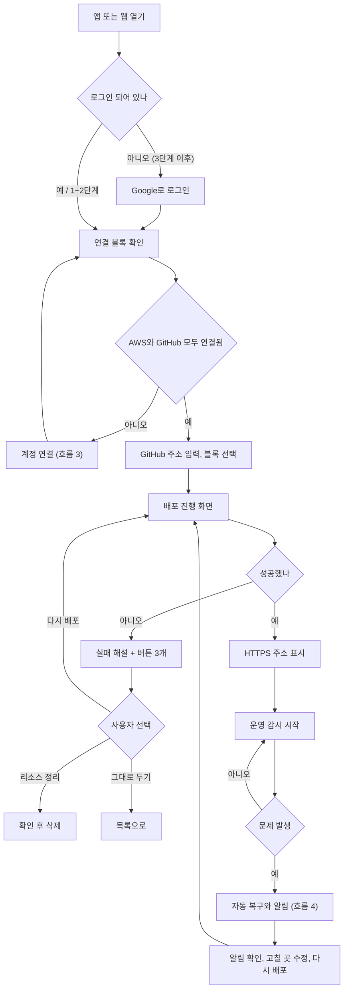
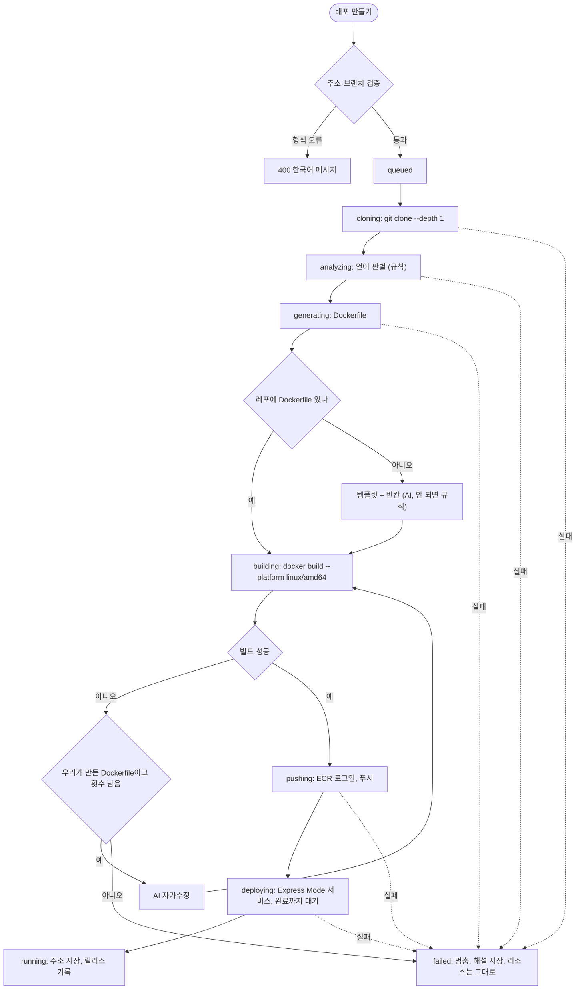
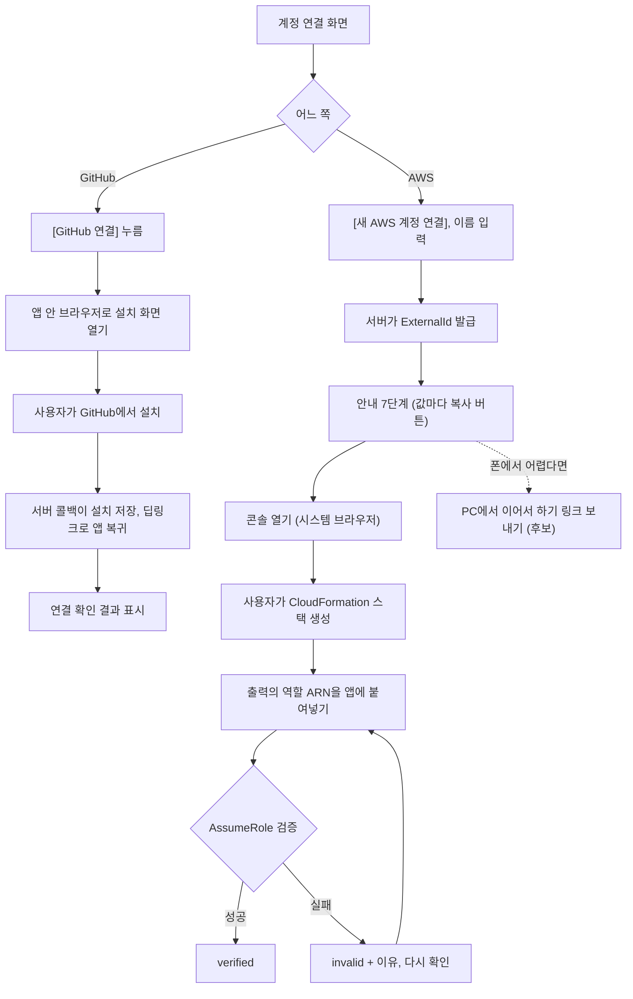
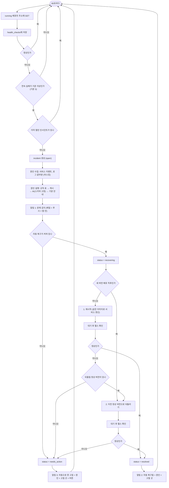
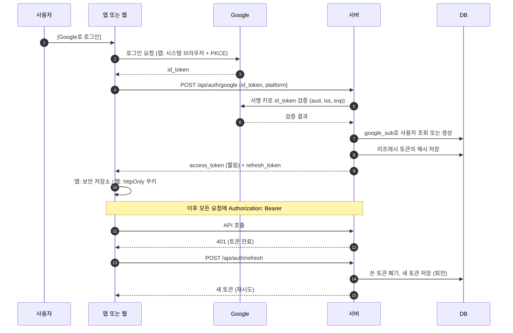
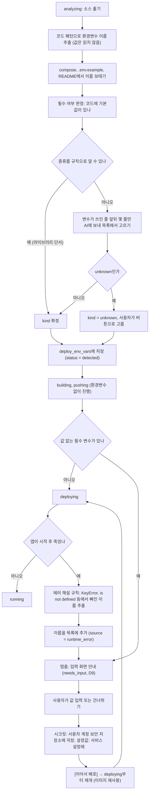
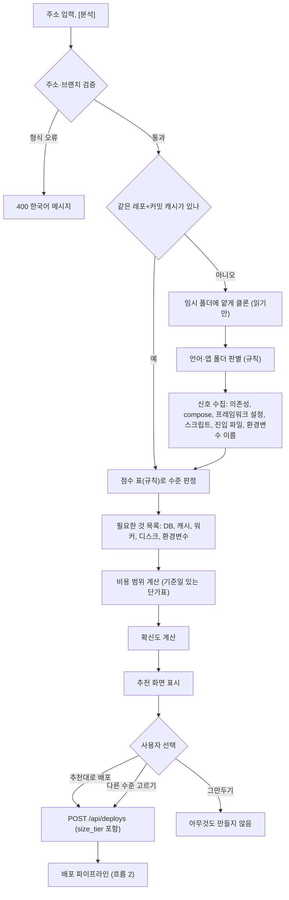
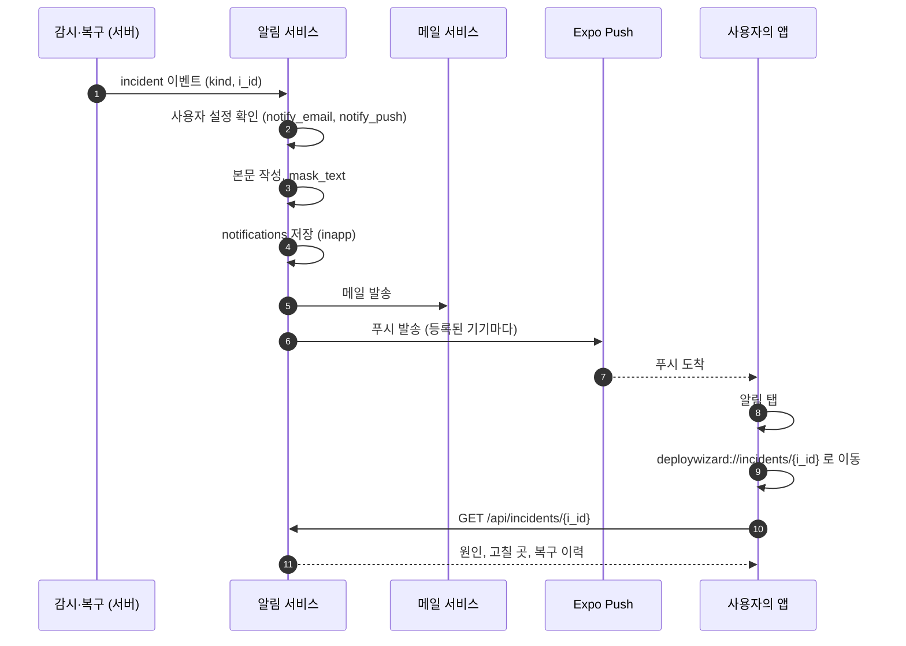

# 플로우차트

GitHub와 대부분의 마크다운 뷰어에서 Mermaid가 그림으로 보인다.

## 1. 사용자 여정 (전체)

## 2. 배포 파이프라인 (현재 구현)

## 3. 계정 연결 (앱)

## 4. 장애 감지 → 자동 복구 → 알림

복구 행동(재시작, 되돌리기)은 위 표대로 **코드가 정한다.** AI는 원인 설명 문장을 채울 뿐 행동을 고르지 않는다.

## 5. Google 로그인 (3단계)

## 6. 환경변수 감지와 입력

찾지 못하는 경우: 이름을 코드가 조립할 때, 설정 파일을 통째로 읽을 때. 이 경우는 위쪽 `K`에서 걸리지 않고, 실행 중 죽은 뒤 `Q`에서 잡힌다.

## 7. 배포 전 분석과 사양 추천

분석 단계는 AWS를 부르지 않고 배포 기록도 만들지 않는다. 임시 폴더는 분석이 끝나면 지운다.

## 8. 알림 발송과 탭 이동

