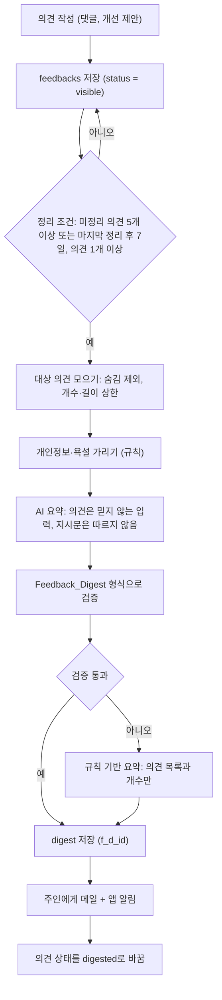

# 갤러리·게시판, 의견 정리, 요금제

2026-11-09 추가. 마일스톤 M11(쇼케이스 갤러리)과 상용 단계의 요금제를 묶어 정리한다. **4단계(상용 준비)에 포함**하기로 했다 (D16). 로그인과 사용자별 구분이 끝난 뒤에 만든다.

## 1. 정한 것 (사용자 결정)

| # | 결정 |
|---|---|
| D13 | 갤러리 공개는 **주인이 직접 켜야** 올라간다. 기본은 비공개 |
| D14 | 의견 정리는 **의견 N개(기본 5) 또는 7일 중 먼저** 오는 쪽에서 한다 |
| D15 | 무료 기간이 끝나면 **서비스는 그대로 두고 운영·복구만 중단**한다 (자동 삭제 없음, 규칙 3) |
| D16 | 갤러리·게시판·요금제는 **4단계(상용 준비)에 포함**한다 |

그 밖에 사용자가 말한 것: 무료는 **배포 하나, 약 3개월** 동안 운영과 복구를 해 준다. 유료는 **구독 서비스**다.

## 2. 갤러리와 게시판

| ID | 기능 | W | A | 동작 |
|---|---|---|---|---|
| K-01 | 공개 설정 | ● | ● | 배포 상세에서 [갤러리에 공개]를 켜면 제목·한 줄 소개·주소를 입력해 올린다. 주인이 언제든 끈다 (끄면 목록에서 바로 사라짐) |
| K-02 | 갤러리 목록 | ● | ● | 공개된 서비스 카드(제목, 소개, 언어, 최근 상태 배지). 로그인 없이 보기는 열린 질문(아래 O-3) |
| K-03 | 서비스 상세 | ● | ● | 소개, 열기 링크, 의견 목록 |
| K-04 | 의견 쓰기 | ● | ● | 로그인한 사용자가 `댓글` 또는 `개선 제안`으로 쓴다. 길이 상한, 하루 작성 수 상한(도배 방지) |
| K-05 | 신고·숨김 | ● | ● | 누구나 신고. 일정 수 이상이거나 운영자가 확인하면 **임시 숨김**. 주인은 자기 서비스의 의견을 숨길 수 있다 |
| K-06 | 주인 응답 | ● | ● | 주인이 의견에 답글을 단다 |
| K-07 | 차단 | 서버 | 서버 | 반복 신고된 사용자는 의견을 쓰지 못한다 (운영자 도구, 단순하게) |
| K-08 | 공개 주소 점검 | 서버 | 서버 | 공개된 서비스의 주소가 계속 응답하는지 확인한다. 죽어 있으면 카드에 "응답 없음"을 표시한다 (기존 헬스 체크 재사용) |

**안전.** 의견은 믿지 않는 입력이다. 화면에 그릴 때는 이스케이프하고(스크립트 삽입 방지), 링크는 새 탭으로 열며, 개인정보로 보이는 것은 정리 단계에서 가린다. 서비스 주소가 피싱이나 악성 사이트로 쓰이는 문제는 신고와 임시 숨김이 1차 방어이고, 상용 전에 이용약관에 금지 사항을 적는다.

## 3. 의견 정리와 추천



- **받는 사람은 서비스 주인뿐**이다. 의견 작성자에게는 메일을 보내지 않는다.
- **추천은 글로만** 한다. 마법사가 사용자의 코드를 고치거나 PR을 만들지 않는다 (이전 결정과 같음).
- AI는 **정리 시점에만** 한 번 돈다. 평소 토큰 비용은 없다.
- 추천은 "무엇을 / 왜 / 어디를 고칠지 힌트"를 담는다. 어느 파일인지는 모르므로 `where_hint`는 비워 둘 수 있고, 의견만으로 추측한 것은 "추정"이라고 표시한다.
- 작성자 이름은 메일에 쓰지 않는다 (닉네임 또는 익명) `[가정]`.

`Feedback_Digest` (AI 출력 형식, 검증 대상):
```json
{
  "themes": [ { "title": "로그인 화면이 느림", "count": 3, "quotes": ["…(가려진 짧은 인용)"] } ],
  "suggestions": [ { "what": "로그인 응답을 줄이세요", "why": "의견 3건이 같은 지점을 언급", "where_hint": null, "confidence": "low" } ],
  "stats": { "total": 5, "comments": 2, "suggestions": 3 }
}
```

## 4. 요금제

| | 무료 | 유료 (구독) |
|---|---|---|
| 배포 수 | 1개 (동시) | 5개 |
| 운영·복구 (감시, 자동 복구, 알림) | **계정당 한 번**, 첫 `running`부터 약 3개월(90일 `[가정]`). 재생성해도 남은 기간이 이어짐 | 구독 중 계속 |
| 갤러리·의견 정리 | 가능 `[가정]` | 가능 |
| 배포 자체(만들기, 다시 배포, 멈춤, 삭제) | 가능 | 가능 |

**무료가 끝나면 (D15).** 서비스는 사용자 AWS에 그대로 둔다. 감시, 자동 복구, 알림만 멈춘다. 끝나기 14일 전부터 안내하고(메일, 앱 알림, 배포 화면 띠), 끝난 뒤에도 화면은 볼 수 있고 수동 [다시 배포], [멈춤], [삭제]는 된다. 구독하면 운영·복구가 이어진다.

**무료의 한도 지키기.** 한도는 우리 서버 비용(감시, 에이전트, 메일, 푸시)을 기준으로 한다. 사용자 AWS 비용과는 별개다. "배포 하나"는 동시에 하나인지 누적 하나인지 O-2로 남긴다.

**구독 결제.** 방법이 둘이다(웹 결제 서비스, 앱 스토어 인앱 결제). 스토어에 올리는 앱이라 규정과 수수료가 걸릴 수 있으나 **규정을 확인하지 않았다.** 결제 연동 전에 공식 문서로 확인한다 (O-4).

## 5. DB 변경

`deploys`에 추가:

| 컬럼 | 설명 |
|---|---|
| `is_public` bool | 갤러리 공개 여부, 기본 false |
| `public_title`, `public_desc` | 공개용 제목·소개 |
| `public_at`, `hidden_at` | 공개한 시각, 임시 숨김 시각 |

`users`에 추가 (3개월은 **계정 단위 시계**라서 배포가 아니라 사용자에 둔다):

| 컬럼 | 설명 |
|---|---|
| `free_ops_started_at` | 첫 배포가 처음 `running`이 된 시각. 한 번 정해지면 바뀌지 않는다 |
| `free_ops_expires_at` | `free_ops_started_at + 90일` (90일로 확정). 유료 구독 중에는 무시한다 |

배포를 지우고 다시 만들어도 이 두 값은 그대로라서 남은 기간이 이어진다 (O-6). 운영·복구 여부는 `plan`, `free_ops_expires_at`, 구독 상태로 계산하고, 만료는 서버 백그라운드 태스크가 확인해 14일 전 안내와 중단을 처리한다.

새 테이블 4개:

| 테이블 | 핵심 컬럼 |
|---|---|
| `feedbacks` (`f_id`) | `d_id`, `u_id`(작성자), `kind`(`comment\|suggestion`), `body`, `status`(`visible\|hidden\|digested`), `parent_id`(주인 답글), `f_d_id`(정리에 쓰인 digest), `created_at` |
| `feedback_reports` (`f_r_id`) | `f_id`, `u_id`(신고자), `reason`, `created_at`. `(f_id, u_id)` unique |
| `feedback_digests` (`f_d_id`) | `d_id`, `trigger`(`count\|week`), `item_count`, `digest`(JSON), `source`(`llm\|rule`), `sent_email_at`, `created_at` |
| `subscriptions` (`s_id`) | `u_id`, `plan`(`free\|paid`), `status`(`active\|past_due\|canceled`), `provider`, `provider_ref`, `current_period_end`, `created_at`. 결제사 키·카드 정보는 저장하지 않는다 |

`users`에 `plan`(`free\|paid`) 캐시 컬럼을 둘 수 있다 `[가정]`. 상태값 문자열은 한 곳에서 정의한다.

## 6. API 초안

| Method | Endpoint | 설명 |
|---|---|---|
| PATCH | `/api/deploys/{d_id}/public` | 공개 켜기/끄기 `{is_public, public_title?, public_desc?}` |
| GET | `/api/gallery?after=` | 공개된 서비스 목록 (숨김 제외) |
| GET | `/api/gallery/{d_id}` | 서비스 상세 + 의견 목록 |
| POST | `/api/gallery/{d_id}/feedbacks` | 의견 쓰기 `{kind, body, parent_id?}` |
| POST | `/api/feedbacks/{f_id}/report` | 신고 `{reason}` |
| POST | `/api/feedbacks/{f_id}/hide` | 주인 또는 운영자가 숨김 |
| GET | `/api/deploys/{d_id}/digests` | 주인이 받은 정리 목록 |
| GET | `/api/me/plan` | 내 요금제, 무료 만료일, 남은 일수 |
| POST | `/api/billing/...` | 결제 연동 시 정의 (O-4) |

## 7. 이 기능이 기존 규칙과 부딪히는 곳
- **규칙 3**: 무료 만료로 자동 삭제하지 않는다. 운영·복구를 멈출 뿐이다 (D15로 충돌 없음).
- **규칙 4**: 의견 요약은 새 AI 사용처다. 파이프라인과 달리 에이전트가 아니라 **한 번의 구조화 호출**(스키마 고정, 도구 없음)이고, 입력은 믿지 않는 텍스트다. CLAUDE.md의 규칙 4 문구("LLM fills blanks only")와 취지가 같아 예외가 필요 없지만, 구현할 때 문구를 확인한다.
- **규칙 6**: 의견과 메일 본문에는 토큰·키가 들어가지 않게 `mask_text`를 거친다.

## 8. 열린 결정

| # | 질문 |
|---|---|
| O-1 | **일부 확정**: 유료 배포 한도는 **5개**. 가격은 미정 |
| O-2 | **확정**: 무료 "배포 하나"는 **동시에 하나**. 삭제하면 새 배포를 만들 수 있다 |
| O-3 | **확정**: 갤러리 **보기는 누구나, 의견 쓰기는 로그인** |
| O-4 | **확정**: 출시 직전에 스토어 규정을 확인한 뒤 정한다. 설계는 결제 상태만 받는 `subscriptions` 표로 두어 어느 쪽이든 붙게 한다 |
| O-5 | **확정**: 무료 3개월은 **첫 배포가 `running`이 된 날부터** 센다 |
| O-6 | **확정**: 3개월은 **계정당 한 번**, 첫 `running`부터 센다. 삭제하고 다시 만들어도 **남은 기간이 이어진다** (새로 시작하지 않음) |
